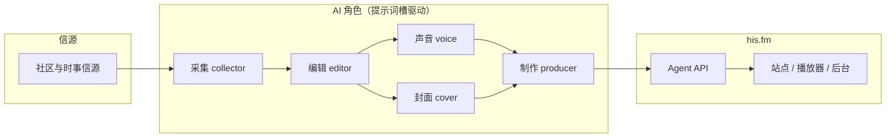

<p align="center">
  <picture>
    <source media="(prefers-color-scheme: dark)" srcset="docs/readme/logo-light.svg">
    
  </picture>
</p>

<p align="center">
  
</p>

<p align="center">
  <a href="https://his.fm"></a>
  <a href="LICENSE"></a>
</p>

<p align="center"><em>由 AI 协作制作的中文播客，大陆普通话播讲。</em></p>

Zheng Li 担任主理人；一组各有分工的 AI 助手负责整条制作流水线：采集高质量社区信源（例如 Hacker News）、栏目编辑撰写逐字稿、声音生成（Gemini TTS 一次生成整期干声）、封面生成、以及制片人角色统筹拼装片头片尾、发布与归档。

这档节目的灵魂不在仓库里的前端与 Worker 代码，而在数据库里可版本化、可通过 Agent API 读写的 **提示词槽（prompt slots）**。本仓库公开的是 **舞台和接口**：听众站点与播放器、逐字稿展示、管理后台，以及外部 AI 客户端用来读取和 PATCH 各角色提示词的 REST 接口。节目正文与媒体在站外生成，再经授权令牌写回。

## 栏目

| Slug | 名称 | 定位 |
| --- | --- | --- |
| `learning` | 每日手冲 | 每天一杯：从 AI 圈里挑几件值得细品的新鲜事，慢慢聊透。 |
| `manager-notes` | 主理人手札 | 从主理人写下的文字出发，聊工作和生活里的体会。 |

## 制作流水线

节目不在网站内嵌「一键生成」。各 AI 角色在站外读取当前提示词与素材，完成自己的环节后，通过 scoped token 写回文稿、媒体与发布状态。



编辑优先级（与运行时合并规则一致）：**频道提示词 → 栏目提示词 → 本期中心思想 → 素材资料**。内部选题边界见 [编辑原则](docs/editorial-policy.md)。

## 提示词槽：节目的「剧本库」

频道与每个栏目各有一张独立的槽位表，在后台 `/admin/channel` 维护；外部客户端使用相同的契约，路径前缀为 `/api/agent`。

### 结构

每个槽位包含：

| 字段 | 含义 |
| --- | --- |
| `id` | 稳定标识（小写 kebab-case，最长 80） |
| `title` | 显示标题 |
| `body` | Markdown 正文 |
| `order` | 排序（升序，再按 `id`） |
| `enabled` | 是否参与合成 |
| `mode` | `append`（在频道正文后追加）或 `override`（栏目覆盖频道同 ID） |
| `version` / `updatedAt` / `updatedBy` | 服务端审计（写入时递增） |

整张表还有集合级 `version` 与 `initialized`。任意写入必须带上当前的表 `version`；过期则返回 **409**，不会部分保存。频道与栏目表版本彼此独立；栏目元数据修改不会改变其槽位表版本。

初始角色 ID（可增删）与合约中的标题映射一致：`positioning`（定位）、`editor`（编辑）、`collector`（采集）、`voice`（声音）、`cover`（封面）、`producer`（制作）、`brand`（品牌）、`skills`（技能名称，每行一个技能名，不是指令正文）。上限：每表最多 64 个槽、标题 120 字、单槽正文 120 000 字、全表正文合计 400 000 字。

栏目读取某角色时，会按 ID 合并已启用的频道槽与栏目槽：`append` 用双换行拼接正文；`override` 仅用栏目正文；栏目槽被禁用**不会**屏蔽仍启用的频道槽。

### HTTP 契约（摘要）

路径均相对于 `/api/agent`；读取需要 `prompts:read`，写入需要 `prompts:write`（与内容写权限分开授予）。

| 路径 | 作用 |
| --- | --- |
| `GET/PUT/POST /channel/prompt-slots` | 频道整张表；`PUT` 一次替换 `{version, slots}` |
| `GET/PUT/POST /categories/{id}/prompt-slots` | 栏目整张表 |
| `PATCH/DELETE …/prompt-slots/{slotId}` | 单槽增量修改（仍带表 `version`） |
| `GET …/prompt-slots?slot=editor,collector` | 合并后的 Markdown `body` 与版本信息 |
| `GET …/migration/dry-run` · `POST …/migration/apply` | 从旧整段提示词显式迁移（只读预览 / 授权后写入） |

仅具写权限、无读权限的客户端，成功写入后可能只收到 `{version}`。

### 示例（占位正文，非生产提示词）

```json
{
  "version": 3,
  "initialized": true,
  "slots": [
    {
      "id": "collector",
      "title": "采集",
      "body": "## 今日信源\n\n（示例）优先 Hacker News 讨论帖，记录链接与要点。",
      "order": 20,
      "enabled": true,
      "mode": "override",
      "version": 2,
      "updatedAt": "2026-01-15T08:00:00.000Z",
      "updatedBy": "agent:collector"
    },
    {
      "id": "editor",
      "title": "编辑",
      "body": "（示例）将素材写成 8–10 分钟口语逐字稿，避免堆砌术语。",
      "order": 30,
      "enabled": true,
      "mode": "append",
      "version": 1,
      "updatedAt": "2026-01-10T12:00:00.000Z",
      "updatedBy": "human:owner"
    }
  ]
}
```

合成阅读时，启用且有正文的槽按 `order` 拼成 Markdown：`## 标题`、空行、正文，槽之间以双换行分隔。细节见 [docs/prompts.md](docs/prompts.md) 与 [docs/api-onboarding.md](docs/api-onboarding.md)。

## 单集材料

部分期数的文稿与核查笔记保存在仓库 `episodes/<slug>/`（中文正文，技术说明为英文）。网站上的正式节目数据在 D1/R2 中管理。

| 期数 | 题目 | 材料 |
| --- | --- | --- |
| 001 | 下班后，还要追多少个 AI？ | [逐字稿](episodes/001-how-to-live-better/transcript.md) · [发表摘要](episodes/001-how-to-live-better/summary.md) · [研究与核查](episodes/001-how-to-live-better/research.md) |

## 技术栈

- **运行时**：单个 [Cloudflare Worker](apps/web/worker/) 处理公开 SSR、管理端 API 与静态资源；无 SPA fallback。
- **数据**：D1（内容与提示词）、R2（媒体与生成物）；公开媒体 CDN 域名为 `f.no.mt`。
- **前端**：React 19、Vite 8、TypeScript 7；公开页 Open Interval 视觉，后台 [@nocoo/basalt](https://github.com/nocoo/basalt) 3.1。
- **契约**：[`packages/contracts`](packages/contracts/) 共享 scope、提示词槽与 WAV 校验。
- **鉴权**：Cloudflare Access 保护 `/admin`；外部客户端使用显式 scope 的 Bearer token（无通配符权限）。

生产站点：**https://his.fm**。本地预览（Caddy 反代）：**https://hisfm.dev.hexly.ai**（仅 loopback）。

## 仓库结构

| 路径 | 说明 |
| --- | --- |
| `apps/web` | 网站、Worker、migrations、Vitest/Playwright（`@his-fm/web`） |
| `packages/contracts` | 共享 Zod 契约与校验 |
| `docs/` | 架构、API、运维、提示词与编辑政策 |
| `artwork/`、`episodes/` | 视觉资产溯源与示例文稿 |
| 根 `package.json` | 单一发布版本号与工作区脚本 |

## 本地开发

需要 Node ≥ 26（与根目录 `package.json` 的 `engines.node` 一致；npm 版本见 `packageManager`）。

```sh
npm ci
npm run dev
```

`npm run dev` 会迁移并种子本地 D1 一次，然后在 `127.0.0.1:7056` 启动 Vite；通过 **https://hisfm.dev.hexly.ai** 访问。本地 Worker 密钥放在 `apps/web/.dev.vars`（见根目录 [`.env.example`](.env.example) 中的占位说明）。

常用检查：

```sh
npm run typecheck
npm run lint
npm run test:coverage
npm run test:e2e
npm run build
```

Husky 对暂存区运行严格 lint、typecheck 与 95% 覆盖率门槛。更多细节见 [docs/operations.md](docs/operations.md)、[docs/architecture.md](docs/architecture.md)。

## 部署概览

生产发布由 **GitHub Release** 触发，经 [nocoo/base-ci](https://github.com/nocoo/base-ci) 可复用工作流：在 tag 对应 commit 上证明 CI 已通过、`package.json` 版本与 tag 一致，再构建 Worker 产物、执行 D1 迁移并 `cf deploy`。部署后校验 `/api/live` 的版本与修订号。不在此文档列出 Cloudflare 密钥；所需 secret 名称见 [docs/ci-cd.md](docs/ci-cd.md)。

## 延伸阅读

- [制作工作流](docs/production.md) · [Agent API](docs/agent-api.md) · [Scoped API](docs/scoped-api.md) · [Episode card API](docs/card-api.md)
- [音频上传](docs/audio.md) · [外观与主题](docs/appearance.md)
- [CI/CD](docs/ci-cd.md) · [视觉资产](artwork/README.md)

## Agent API 契约摘录（英文，与 OpenAPI 同步）

以下段落与 `docs/agent-api.md`、`docs/api-onboarding.md` 及发布的 OpenAPI 描述保持一致，便于外部客户端对照实现。

### API prompt slots

Prompt slots use GET/PUT/POST /channel/prompt-slots and /categories/{id}/prompt-slots, plus PATCH/DELETE /{slotId}. Reads require prompts:read; all writes require prompts:write, independently of category metadata grants. Mutations use the collection version; write-only responses contain only version. Category append adds after the same channel ID; override replaces it. Disabled category slots do not mask channel. Enabled results sort by order then ID. GET /migration/dry-run below either table is read-only; POST /migration/apply with version and legacyVersion explicitly initializes slots with an atomic original-value backup. Nothing auto-applies on deploy; reapply is a no-op. Old channel.content, channel.prompts.* and category.prompt are read-only: stored values until apply, then enabled local slots concatenated as Markdown. New clients must use slots; compatibility removal requires a separately announced, verified consumer cutover.

Paths are relative to `/api/agent`. Read [onboarding](docs/api-onboarding.md#prompt-slot-transition) and [prompt slots](docs/prompts.md) before migration. The studio keeps local drafts and saves a level's complete slot table atomically; `skills` accepts names only. The founding Chinese editorial policy lives in [docs/editorial-policy.md](docs/editorial-policy.md).

### API cover artwork

Uploading a clean cover with `PUT /api/agent/productions/{id}/assets/cover?version=N` pregenerates square podcast art and landscape share images as immutable generated R2 objects before publication; publishing or republishing warms the linked episode's artwork keys. Use a **1400 x 1400 square original** (smaller originals are accepted), without text, logos, borders or overlays. Keep essential subjects near **x = 50%, y = 40%** for the share crop; on square originals its safe-area band spans **y = 13.75-66.25%**.

Public published-only `/episodes/{id}/art.jpg` and `/episodes/{id}/share.jpg` resolve to versioned URLs (`art.jpg?v=<hash>`, optionally with `&size=N`, and `share.jpg?v=<hash>`). Square art follows the website theme, defaults to 1400 square and accepts sizes from 1400 through 3000; the 1200 x 630 landscape image is theme-independent. Only generated outputs are cached, never replacements for originals; storage cleanup protects current generated versions. See [API onboarding](docs/api-onboarding.md#cached-podcast-and-share-artwork) and [appearance](docs/appearance.md#public-rss-and-share-artwork).

Successful versioned artwork responses and 304s include x-hisfm-art: edge-hit | r2-hit | rendered. After successful cover upload/publication warming, the first default 1400-square art or share GET should report r2-hit (pregenerated), not rendered (lazy fallback); an already warm edge may report edge-hit. Repeat GETs to the same full versioned URL at the same edge should become edge-hit after asynchronous cache fill, not globally guaranteed. Other sizes may render. HEAD reads cached GET metadata without a body and cannot warm the edge; cold HEAD/304 may use only R2 metadata without populating it. Conditional 304s honor the same ETag and Last-Modified validators.

## 许可证

本仓库源代码以 [MIT License](LICENSE) 发布，版权归 Zheng Li（2026）所有。节目文稿、提示词正文与已发布媒体可能受单独版权约束；仓库内示例与占位文本仅作说明用途。

---

## English summary

**his.fm** is a Mandarin podcast produced with a pipeline of external AI agents (research, scripting, Gemini TTS narration, cover art, producing). This repository is the **stage and API**: the public site, player, transcripts, admin studio, and versioned **prompt slots** in D1 that agents read and patch over `/api/agent`. Content generation is out-of-band; the Worker enforces scopes, optimistic concurrency, and publication rules. Stack: React 19 + Vite on one Cloudflare Worker with D1 and R2. Local dev: `npm ci` && `npm run dev` → https://hisfm.dev.hexly.ai . Production: https://his.fm , deployed from GitHub Releases after CI.
