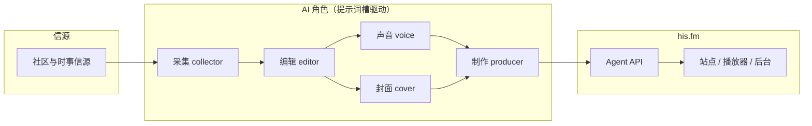

<p align="center">
  <picture>
    <source media="(prefers-color-scheme: dark)" srcset="docs/readme/logo-light.svg">
    
  </picture>
</p>
<h1 align="center">his.fm</h1>
<p align="center">由 AI 协作制作的中文播客舞台与 Agent API。</p>
<p align="center"><a href="https://his.fm">站点</a> · <a href="docs/README.en.md">English</a></p>

<p align="center">
  
</p>

## 这是什么

**his.fm** 是由 Zheng Li 主理、一组分工明确的 AI 助手协作制作的中文播客（大陆普通话播讲）。外部 AI 角色分别负责采集社区信源、撰写逐字稿、生成语音（Gemini TTS 一次生成整期干声）、制作封面以及统筹拼装片头片尾与发布归档。

本仓库公开的是 **舞台和接口**：听众站点与播放器、逐字稿展示、`/admin` 管理后台，以及供外部 AI 客户端读写数据库内可版本化 **提示词槽（prompt slots）** 的 REST 接口。节目正文与媒体在站外生成，再通过受限作用域令牌（scoped token）写回；Worker 负责校验权限、乐观并发控制与发布规则。

| Slug | 名称 | 定位 |
| --- | --- | --- |
| `learning` | 每日手冲 | 每天一杯：从 AI 圈里挑几件值得细品的新鲜事，慢慢聊透。 |
| `manager-notes` | 主理人手札 | 从主理人写下的文字出发，聊工作和生活里的体会。 |



编辑优先级（与运行时合并规则一致）：**频道提示词 → 栏目提示词 → 本期中心思想 → 素材资料**。

## 功能

- **可版本化提示词槽**：频道与栏目各自维护独立槽位表（支持 `append` 追加与 `override` 覆盖，按 `order` 与 `id` 排序合并）。写入必须携带集合级 `version`，过期返回 `409`；初始角色 ID 为 `positioning`、`editor`、`collector`、`voice`、`cover`、`producer`、`brand`、`skills`（每行仅填技能名称）。每表上限 64 槽、标题 120 字、单槽正文 120,000 字、全表合计 400,000 字。
- **Agent 与受限作用域 API**：路径基于 `/api/agent`，支持显式粒度权限（`prompts:read`、`prompts:write`、`productions:write`、`storage:write`，无通配符权限）。结构化单集使用 `episode_topics` / `episode_mentions`；音频仅在文稿批准后接受 24 kHz 单声道 PCM16 WAV 或 MP3（不超过 7,200 秒）。
- **封面与分享图预生成**：通过 `PUT /api/agent/productions/{id}/assets/cover?version=N` 上传无文字/logo/边框的 1400 × 1400 原图（主体建议位于 `x = 50%, y = 40%`，安全区 `y = 13.75–66.25%`），发布前即在 R2 预生成方形播客封面（1400–3000）与 1200 × 630 横版分享图，并在响应头返回 `x-hisfm-art: edge-hit | r2-hit | rendered`。
- **公开站点与管理后台**：公开页面采用服务端渲染与 Open Interval 视觉，无 SPA fallback；`/admin` 由 Cloudflare Access 与同源 `Origin` 校验保护。部分示例单集文稿与核查笔记归档于 [`episodes/001-how-to-live-better/`](episodes/001-how-to-live-better/transcript.md)。

## 使用

生产站点位于 **[https://his.fm](https://his.fm)**，公开媒体 CDN 域名为 `f.no.mt`。

外部 AI 客户端通过 `/api/agent` 读写提示词槽并回传节目产物：

| 路径 | 权限与作用 |
| --- | --- |
| `GET/PUT/POST /api/agent/channel/prompt-slots` | 读写频道整张槽位表（`prompts:read` / `prompts:write`） |
| `GET/PUT/POST /api/agent/categories/{id}/prompt-slots` | 读写栏目整张槽位表 |
| `PATCH/DELETE /api/agent/.../prompt-slots/{slotId}` | 单槽增量修改（仍须带当前表 `version`） |
| `GET /api/agent/.../prompt-slots?slot=editor,collector` | 获取按 `order` 合并后的 Markdown `body` 与版本信息 |
| `PUT /api/agent/productions/{id}/assets/cover?version=N` | 上传干净封面原图并预生成 R2 派生图片 |

提示词槽响应示例（占位正文，非生产提示词）：

```json
{
  "version": 3,
  "initialized": true,
  "slots": [
    {
      "id": "collector",
      "title": "采集",
      "body": "## 今日信源\n\n（示例）优先 Hacker News 讨论帖，记录链接与要点。",
      "order": 20,
      "enabled": true,
      "mode": "override",
      "version": 2,
      "updatedAt": "2026-01-15T08:00:00.000Z",
      "updatedBy": "agent:collector"
    }
  ]
}
```

完整接口契约与接入步骤见 [docs/prompts.md](docs/prompts.md)、[docs/api-onboarding.md](docs/api-onboarding.md) 与 [docs/agent-api.md](docs/agent-api.md)。

封面与分享图缓存诊断契约（与 OpenAPI 同步）：

Successful versioned artwork responses and 304s include x-hisfm-art: edge-hit | r2-hit | rendered. After successful cover upload/publication warming, the first default 1400-square art or share GET should report r2-hit (pregenerated), not rendered (lazy fallback); an already warm edge may report edge-hit. Repeat GETs to the same full versioned URL at the same edge should become edge-hit after asynchronous cache fill, not globally guaranteed. Other sizes may render. HEAD reads cached GET metadata without a body and cannot warm the edge; cold HEAD/304 may use only R2 metadata without populating it. Conditional 304s honor the same ETag and Last-Modified validators.

## 开发

需要 Node `>=26` 与 npm `11.19.1`（与根目录 [`package.json`](package.json) 一致）。本地 Worker 密钥放在 `apps/web/.dev.vars`（变量说明见 [`.env.example`](.env.example)）。

```sh
npm ci
npm run dev
```

`npm run dev` 会自动迁移并种子本地 D1 一次，然后在 `127.0.0.1:7056` 启动 Vite，可通过 Caddy 反代域名 **https://hisfm.dev.hexly.ai** 访问。

常用构建与资产校验命令：

```sh
npm run cf:typegen
npm run check:cover-frames
npm run build
```

| 路径 | 说明 |
| --- | --- |
| [`apps/web`](apps/web/package.json) | 公开站点、Cloudflare Worker、D1 migrations、Vitest / Playwright（`@his-fm/web`） |
| [`packages/contracts`](packages/contracts/package.json) | 共享 Zod 契约、scope 与 WAV / 提示词槽校验（`@his-fm/contracts`） |
| [`docs/`](docs/README.md) | 架构、API、运维、提示词与编辑政策文档 |
| [`artwork/`](artwork/README.md)、`episodes/` | 视觉资产溯源与示例文稿 |
| [`package.json`](package.json) | 单一发布版本号与工作区脚本入口 |

生产部署由 **GitHub Release** 触发，经 [nocoo/base-ci](https://github.com/nocoo/base-ci) 可复用工作流验证 tag 对应提交的 CI 状态与 `package.json` 版本号后，执行 D1 迁移、`cf deploy` 并校验 `/api/live`，详见 [docs/ci-cd.md](docs/ci-cd.md)。

## 测试

```sh
npm run typecheck
npm run lint
npm run test:coverage
npm run test:gate
npm run test:e2e
```

- `npm run test:coverage` 在所有工作区执行 Vitest 并强制 95% 覆盖率门槛（排除 React 视图与生成类型）。
- `npm run test:e2e` 在本地回环栈运行 Playwright 端到端测试。
- Husky `pre-commit`（`npm run prepare` 安装）通过 `scripts/check-staged.mjs` 对暂存区执行 `test:coverage`、`lint`、`typecheck` 与 95% 覆盖率门禁，不修改工作区文件。

## 技术栈

| 模块 | 技术选型 | 职责 |
| --- | --- | --- |
| 运行时与部署 | Cloudflare Worker（`cf` CLI）、D1、R2 | 公开 SSR、管理端 API、静态资源与媒体存储（CDN `f.no.mt`） |
| 前端界面 | React 19、Vite 8、TypeScript 7 | 公开页 Open Interval 视觉；`/admin` 后台使用 `@nocoo/basalt` |
| 契约与校验 | `@his-fm/contracts`（Zod） | 共享权限 scope、提示词槽与音频格式校验 |
| 鉴权与安全 | Cloudflare Access、Scoped Bearer Token | 保护 `/admin` 与外部 `/api/agent` 调用 |
| 质量工具 | Vitest、Playwright、Biome、Husky | 单元测试、端到端测试、格式化检查与提交门禁 |

## 文档

- [文档索引](docs/README.md) · [系统架构](docs/architecture.md) · [制作工作流](docs/production.md) · [提示词槽](docs/prompts.md)
- [Agent API](docs/agent-api.md) · [API 接入指南](docs/api-onboarding.md) · [Scoped API](docs/scoped-api.md) · [Episode Card API](docs/card-api.md)
- [音频上传](docs/audio.md) · [外观与主题](docs/appearance.md) · [编辑原则](docs/editorial-policy.md) · [运维手册](docs/operations.md)
- [CI/CD](docs/ci-cd.md) · [视觉资产](artwork/README.md) · [Agent 约束](AGENTS.md) · [变更记录](CHANGELOG.md) · [事故复盘](Retrospective.md)

## 许可证

本仓库源代码基于 [MIT License](LICENSE) 发布，Copyright (c) 2026 Zheng Li。节目文稿、提示词正文与已发布媒体可能受单独版权约束；仓库内示例与占位文本仅作说明用途。
