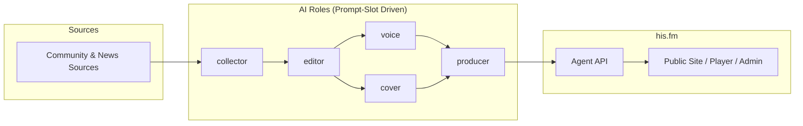

<p align="center">
  <picture>
    <source media="(prefers-color-scheme: dark)" srcset="readme/logo-light.svg">
    
  </picture>
</p>
<h1 align="center">his.fm</h1>
<p align="center">Stage and Agent API for an AI-produced Mandarin podcast.</p>
<p align="center"><a href="https://his.fm">Website</a> · <a href="../README.md">简体中文</a></p>

<p align="center">
  
</p>

## What it does

**his.fm** is a Mandarin podcast hosted by Zheng Li and produced by a pipeline of specialized external AI agents covering community source collection, script editing, voice synthesis (single-pass Gemini TTS), cover art generation, and final assembly and publishing.

This repository is the **stage and API**: the public SSR site and audio player, transcript viewer, `/admin` studio, and REST endpoints for external AI clients to read and patch versioned **prompt slots** stored in D1. Episode copy and media are generated out-of-band and written back with scoped Bearer tokens, while the Worker enforces permissions, optimistic concurrency, and publication rules.

| Slug | Name | Focus |
| --- | --- | --- |
| `learning` | 每日手冲 (Daily Pour-Over) | Daily deep dives into noteworthy stories from the AI ecosystem. |
| `manager-notes` | 主理人手札 (Host's Notes) | Reflections on engineering management, work, and life from the host's notes. |



Editorial priority (matching runtime merge order): **Channel prompts → Category prompts → Episode thesis → Source materials**.

## Features

- **Versioned Prompt Slots**: Channel and category levels each maintain an independent slot table (`append` and `override` merge modes, sorted by `order` then `id`). Writes require the collection `version` and return `409` on stale writes; default role IDs are `positioning`, `editor`, `collector`, `voice`, `cover`, `producer`, `brand`, and `skills` (skill names only, one per line). Limits: 64 slots per table, 120 chars per title, 120,000 chars per slot body, and 400,000 chars per table.
- **Agent & Scoped APIs**: Routes under `/api/agent` enforce finite-grant scopes (`prompts:read`, `prompts:write`, `productions:write`, `storage:write` with no wildcards). Structured episodes use `episode_topics` / `episode_mentions`; audio uploads require an approved script and accept 24 kHz mono PCM16 WAV or MP3 (`<= 7,200s`).
- **Pregenerated Cover & Share Artwork**: Uploading a clean 1400 × 1400 original (no text, logos, borders, or overlays; keep subjects near `x = 50%, y = 40%`, safe-area band `y = 13.75–66.25%`) via `PUT /api/agent/productions/{id}/assets/cover?version=N` pregenerates versioned square podcast art (1400–3000) and 1200 × 630 landscape share images in R2, reporting `x-hisfm-art: edge-hit | r2-hit | rendered`.
- **Public SSR & Admin Studio**: Public routes render server-side with the Open Interval theme and no SPA fallback; `/admin` is protected by Cloudflare Access and same-origin `Origin` checks. Sample episode transcripts and research notes are archived under [`episodes/001-how-to-live-better/`](../episodes/001-how-to-live-better/transcript.md).

## Usage

The production site is live at **[https://his.fm](https://his.fm)**, with public media served from CDN `f.no.mt`.

External AI clients integrate over `/api/agent` to read prompt slots and upload production assets:

| Endpoint | Scope & Purpose |
| --- | --- |
| `GET/PUT/POST /api/agent/channel/prompt-slots` | Read or replace the channel prompt-slot table (`prompts:read` / `prompts:write`) |
| `GET/PUT/POST /api/agent/categories/{id}/prompt-slots` | Read or replace a category prompt-slot table |
| `PATCH/DELETE /api/agent/.../prompt-slots/{slotId}` | Incrementally update or delete one slot (requires current table `version`) |
| `GET /api/agent/.../prompt-slots?slot=editor,collector` | Fetch merged Markdown `body` and version metadata ordered by `order` |
| `PUT /api/agent/productions/{id}/assets/cover?version=N` | Upload clean cover art and pregenerate derived R2 artwork |

Example prompt-slot payload (placeholder text, not production prompts):

```json
{
  "version": 3,
  "initialized": true,
  "slots": [
    {
      "id": "collector",
      "title": "Collector",
      "body": "## Today's Sources\n\n(Example) Prioritize Hacker News threads and capture links with key takeaways.",
      "order": 20,
      "enabled": true,
      "mode": "override",
      "version": 2,
      "updatedAt": "2026-01-15T08:00:00.000Z",
      "updatedBy": "agent:collector"
    }
  ]
}
```

See [prompts.md](prompts.md), [api-onboarding.md](api-onboarding.md), and [agent-api.md](agent-api.md) for full schemas and limits.

Cover and share artwork cache diagnostics contract (synced with OpenAPI):

Successful versioned artwork responses and 304s include x-hisfm-art: edge-hit | r2-hit | rendered. After successful cover upload/publication warming, the first default 1400-square art or share GET should report r2-hit (pregenerated), not rendered (lazy fallback); an already warm edge may report edge-hit. Repeat GETs to the same full versioned URL at the same edge should become edge-hit after asynchronous cache fill, not globally guaranteed. Other sizes may render. HEAD reads cached GET metadata without a body and cannot warm the edge; cold HEAD/304 may use only R2 metadata without populating it. Conditional 304s honor the same ETag and Last-Modified validators.

## Development

Requires Node `>=26` and npm `11.19.1` (matching root [`package.json`](../package.json)). Local Worker secrets live in `apps/web/.dev.vars` (variable names documented in [`.env.example`](../.env.example)).

```sh
npm ci
npm run dev
```

`npm run dev` migrates and seeds local D1 once, then starts Vite on `127.0.0.1:7056`, served locally via Caddy at **https://hisfm.dev.hexly.ai**.

Build and asset verification commands:

```sh
npm run cf:typegen
npm run check:cover-frames
npm run build
```

| Path | Description |
| --- | --- |
| [`apps/web`](../apps/web/package.json) | Public site, Cloudflare Worker, D1 migrations, Vitest / Playwright (`@his-fm/web`) |
| [`packages/contracts`](../packages/contracts/package.json) | Shared Zod schemas, scopes, and WAV / prompt-slot validators (`@his-fm/contracts`) |
| [`docs/`](README.md) | Architecture, API, operations, prompt-slot, and editorial policy docs |
| [`artwork/`](../artwork/README.md), `episodes/` | Artwork provenance and archived episode materials |
| [`package.json`](../package.json) | Single release version and workspace script entrypoints |

Production deployments are triggered by **GitHub Releases** through [nocoo/base-ci](https://github.com/nocoo/base-ci), verifying green CI on the tagged commit and `package.json` version parity before applying D1 migrations, running `cf deploy`, and checking `/api/live`. See [ci-cd.md](ci-cd.md).

## Tests

```sh
npm run typecheck
npm run lint
npm run test:coverage
npm run test:gate
npm run test:e2e
```

- `npm run test:coverage` runs Vitest across workspaces with a 95% coverage floor (excluding React views and generated types).
- `npm run test:e2e` runs Playwright against the local loopback dev stack.
- Husky `pre-commit` (installed via `npm run prepare`) runs `scripts/check-staged.mjs` on staged files for `test:coverage`, `lint`, `typecheck`, and the 95% floor without mutating the worktree.

## Stack

| Layer | Technology | Role |
| --- | --- | --- |
| Runtime & Storage | Cloudflare Worker (`cf` CLI), D1, R2 | Public SSR, admin API, static assets, and media CDN (`f.no.mt`) |
| Frontend | React 19, Vite 8, TypeScript 7 | Open Interval public UI; `@nocoo/basalt` `/admin` studio |
| Contracts | `@his-fm/contracts` (Zod) | Shared scope, prompt-slot, and audio validation |
| Auth & Security | Cloudflare Access, Scoped Bearer Tokens | Protects `/admin` and external `/api/agent` routes |
| Quality | Vitest, Playwright, Biome, Husky | Unit tests, E2E suite, lint/format checks, and commit gates |

## Documentation

- [Docs Index](README.md) · [Architecture](architecture.md) · [Production Workflow](production.md) · [Prompt Slots](prompts.md)
- [Agent API](agent-api.md) · [API Onboarding](api-onboarding.md) · [Scoped API](scoped-api.md) · [Episode Card API](card-api.md)
- [Audio Upload](audio.md) · [Appearance & Themes](appearance.md) · [Editorial Policy](editorial-policy.md) · [Operations](operations.md)
- [CI/CD](ci-cd.md) · [Artwork Provenance](../artwork/README.md) · [AGENTS.md](../AGENTS.md) · [Changelog](../CHANGELOG.md) · [Retrospective](../Retrospective.md)

## License

Source code is released under the [MIT License](../LICENSE), Copyright (c) 2026 Zheng Li. Episode transcripts, prompt bodies, and published media may be subject to separate copyright; repository samples and placeholder text are for illustration only.
